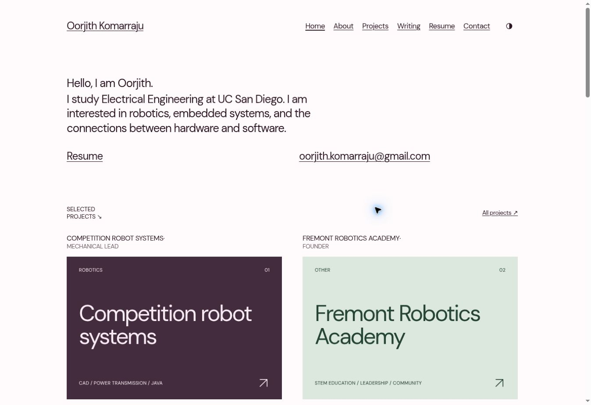

# Oorjith Komarraju — Engineering & Beyond

A complete, static personal website with an editorial design, six primary sections, project case studies, separate personal writing and engineering notes, and two ways to maintain the same content. Start with **[START_HERE.md](START_HERE.md)**. Everyday updates are covered in **[CONTENT_GUIDE.md](CONTENT_GUIDE.md)**.

## Architecture

- **Astro 7.4.2**, TypeScript strict mode, native Astro components, static HTML output.
- **Tailwind CSS 4.3.3**, with centralized semantic CSS tokens in `src/styles/global.css`.
- **Astro Content Collections** with validated schemas in `src/content.config.ts`.
- Markdown for visual editing; MDX for advanced technical content. No React or client framework.
- **Pages CMS** edits repository files through its hosted GitHub integration. There is no site database or custom authentication service.
- **GitHub Actions → GitHub Pages**, with origin and base path derived from Pages settings.
- Self-hosted Newsreader, DM Sans, and IBM Plex Mono fonts. See `public/font-licenses/`.
- Build-time math and syntax highlighting. Sharp generates responsive WebP variants for local raster images. No client-side math renderer or image service is needed.

Astro 7 uses a new default Markdown engine. This project explicitly selects the supported `@astrojs/markdown-remark` unified pipeline so `remark-math`, `rehype-katex`, and the base-path/media transformer share a tested pipeline with MDX 8.1.1. The lockfile fixes the complete compatible dependency graph. KaTeX is overridden to 0.19.1 throughout the graph to avoid older transitive versions; rich-content integration tests cover the renderer. Sharp is pinned to 0.35.5.

## Development

Install Node.js **24 LTS**. From the repository root:

```sh
npm ci
npm run dev
```

Open the URL printed by Astro. Development normally serves at `/`, regardless of the production repository subpath.

```sh
npm run check         # Astro/TypeScript, CMS structure, content/configuration checks
npm test              # URL/base-path regression tests
npm run build         # Generate sharing image, optimize media, build static pages
npm run preview       # Serve the production output; use the printed subpath
npm run verify        # Check, test, build, and crawl the generated output
npm run test:content  # Temporary create/edit/MDX/media test, then restore a clean build
npm run qa:prepare   # Install temporary browser QA fixtures
npm run qa:clean     # Remove browser QA fixtures before building
```

`test:content` temporarily edits one known project and creates disposable fixtures; it restores the original and deletes fixtures in a `finally` block. Run it with no concurrent content editor or dev process. No fixtures remain published. It also verifies nullable optional CMS fields and homepage setting edits. It checks a new auto-featured project, an MDX article, edit propagation, math, code, tables, table of contents, images, and local links.

For browser checks, run `npm run qa:prepare`, then `npm run dev`, and open `/qa-responsive/`. Select **Audit all pages in both themes** to run axe-core and overflow checks inside 375, 768, and 1440 px iframes. The query links select an individual page. These are browser layout viewports, not physical-device emulation. Stop the dev server and run `npm run qa:clean` afterward. The production build refuses to run while the temporary routes are present. Fixtures live under `tests/fixtures/`, outside all content collections.

## File map

| Location | Purpose |
| --- | --- |
| `src/config/site.json` | Identity, contact links, homepage copy, current focus, navigation, categories, SEO, URL defaults |
| `src/config/site.ts` | Validates the shared settings and derives social links |
| `src/content/pages/about.md` | About copy |
| `src/content/pages/resume.md` | HTML resume summary |
| `src/content/projects/` | Markdown or MDX project entries |
| `src/content/writing/` | Markdown or MDX articles |
| `src/content/experience/` | Experience entries |
| `src/content.config.ts` | Schemas and collection loaders |
| `src/pages/` | Static routes and automatic collection routes |
| `src/layouts/` | Shared page, project, and article layouts |
| `src/components/` | Navigation, project rows, media, links, footer |
| `src/styles/global.css` | Design tokens, responsive system, reading typography |
| `public/images/` | Original uploaded project and personal images |
| `public/resume.pdf` | Downloadable resume; replace in place |
| `.pages.yml` | Visual editing and media configuration |
| `.github/workflows/deploy.yml` | Validation and deployment |
| `templates/` | Copyable, unpublished authoring templates |
| `scripts/` | Small build helpers and verification scripts |
| `VERIFICATION.md` | What was actually tested and what remains account-dependent |

## Content behavior

Project and article URLs follow filenames. `competition-robot-systems.md` becomes `/projects/competition-robot-systems/`. Nested folders create nested URLs. Use lowercase, hyphenated filenames. Do not use frontmatter `slug` overrides: filenames are the single source of truth for route identity.

All collection calls used for public routes, indexes, related work, and featured work filter drafts. Projects and articles default to `draft: true`. Sitemap entries come from generated public routes. Optional dates and details are omitted rather than invented. Project categories are strings, with filter options derived from global suggestions plus published content. Featured projects sort by `featuredOrder` and are selected automatically. The project gallery uses uploaded images when present and generates a typographic cover from the same metadata otherwise. Writing uses `kind: personal` (default) or `kind: technical`; personal entries feed the homepage automatically.

The initial public project entries cover competition robot systems, Fremont Robotics Academy, and an Eagle Scout service project. The autonomy and power-distribution entries are drafts. Writing has a deliberate empty state; the first-note template is unpublished.

## Deployment to GitHub Pages

1. Put these files at the root of your chosen GitHub repository on `main`. Include dotfiles, especially `.github/` and `.pages.yml`; do not upload `node_modules/` or `dist/`.
2. In **Settings → Pages → Build and deployment → Source**, select **GitHub Actions**.
3. Allow GitHub Actions for the repository. The workflow uses `contents: read`; only the deployment job gets `pages: write` and `id-token: write`.
4. Push to `main`, or run **Actions → Build and deploy portfolio → Run workflow**.
5. Open the URL in the successful deployment. Do not assume the URL until GitHub returns it.

The workflow also validates pull requests without deploying them. A failed check prevents the deployment job and leaves the previous site intact. Check the failed step in Actions to see the error.

**GitHub Free requires a public repository for Pages.** Private repositories require a qualifying GitHub plan. Pages CMS itself works through a selected-repository GitHub App installation; it does not require making the repository public. A private source repository does not necessarily make the deployed Pages website private. The existing `engineering-portfolio` repository was private when inspected; no repository visibility or existing source was changed during this implementation.

### URL and base-path configuration

`astro.config.mjs` uses this precedence:

1. `SITE_URL` and `BASE_PATH` environment variables.
2. `src/config/site.json` production defaults: `https://havefunok.github.io` and `/engineering-portfolio`.
3. Development uses `/` unless explicitly overridden.

GitHub Actions populates the variables from `actions/configure-pages` outputs. Thus a differently named repository works without changing components. Optional repository **Variables** named `SITE_URL` and `BASE_PATH` override those detected values. Use `/` explicitly for a root deployment.

All navigation and configured assets go through `src/lib/urls.ts`. Authored root-relative Markdown links, images, and posters are transformed during rendering. MDX media components use the same helper. Root and subpath builds are checked by the output crawler.

For a custom domain, set it in **Settings → Pages → Custom domain**, follow GitHub's DNS instructions, and enable HTTPS when available. The next build reads the new origin and base path from Pages settings. Set `siteUrl` to that origin and `basePath` to `/` for matching local production previews. Remove old repository variable overrides if they would conflict. No custom server is needed.

### Private review deployment

The `.openai/hosting.json` file belongs to the private review deployment in ChatGPT. GitHub Pages does not use it. The downloadable GitHub package omits that provider-specific identity. The review site and a future GitHub Pages site have separate publishing controls; a successful private review deployment is not evidence of a GitHub Pages deployment.

## Pages CMS verification and boundaries

The current official documentation and source schema were checked for content models, GitHub authentication, repository installation, media paths, and Markdown support. `.pages.yml` was validated against upstream `lib/config-schema.ts` (blob `cc434fd87bcebc80aa8fe777b99c7d0f943ef11f`) as well as local path/model checks.

The configuration includes site settings, About, resume summary, projects, writing, experience, image uploads, and PDF uploads. Rich-text fields save Markdown with YAML frontmatter; settings save JSON. MDX is excluded from visual collections. Rich-text editors can normalize specialized syntax, so use Source mode for equations or unusual Markdown and GitHub/code editing for MDX.

**Configuration validation does not prove authentication or saving in your account.** Follow the real editing test in `START_HERE.md`. No CMS login credentials are stored in the project. The hosted editor uses its supported GitHub App flow, not a custom auth backend.

## Images and performance

Put original raster images in `public/images/`. At build time `scripts/media.mjs` produces content-hashed WebP widths up to 1920 px in `public/_media/`; the media component and Markdown transformer use responsive `srcset`, sizes, intrinsic dimensions, and lazy loading. Hero images can opt into eager loading. SVG diagrams remain SVG. Restart the development server after adding a new image so the optimization manifest refreshes. Production builds always rescan.

Generated `_media` assets and `.astro/media.json` are ignored by Git. Originals remain available at their stable URLs. The homepage uses type instead of fabricated imagery. The sharing PNG and favicon regenerate from site settings and the semantic color tokens on every build. A portrait is optional.

The shipped JavaScript handles only theme selection, mobile menu Escape behavior, and project filtering. Navigation and content work without JavaScript; filters and the theme button appear only when their scripts run. No analytics, tracking pixels, contact backend, or client framework is included.

## Accessibility and validation

Semantic landmarks, one H1 per page, skip link, native disclosure navigation, keyboard focus, live filter counts, descriptive alt text, reduced motion, and light/dark contrast are included. Math is rendered with accessible MathML. The HTML resume supplements the untagged downloadable PDF. Browser and automated results, including the limits of Lighthouse verification, are recorded in `VERIFICATION.md`.

## Content provenance

The prose was revised using the two supplied HUM 100 reading reflections as writing-style references. The supplied brief, verified GitHub profile, and existing `havefunok/engineering-portfolio` About and project files informed initial copy. The user-provided history supplied Eagle Scout project details and interests. No employer, degree date, project date, publication, performance measurement, project repository, or LinkedIn address was invented. The current `public/resume.pdf` is an unchanged copy of the user-supplied `Oorjith_Komarraju_Resume_Classic.pdf`. Its education, experience, project summaries, research interests, skills, recognition, LinkedIn URL, and updated Fremont Robotics Academy figures inform the HTML resume and shared profile content. Month-only role dates use the first day internally and display only month/year. Unknown dates remain omitted.

## Official references

- [Astro v7 migration and Markdown pipeline](https://docs.astro.build/en/guides/upgrade-to/v7/)
- [Astro GitHub Pages deployment](https://docs.astro.build/en/guides/deploy/github/)
- [Pages CMS quick start](https://pagescms.org/docs/quick-start/)
- [Pages CMS content configuration](https://pagescms.org/docs/configuration/content/)
- [Pages CMS media configuration](https://pagescms.org/docs/configuration/media/)
- [Pages CMS rich-text field](https://pagescms.org/docs/configuration/fields/rich-text/)
- [Pages CMS GitHub App permissions](https://pagescms.org/docs/guides/installing/github-app/)
- [GitHub Pages availability and setup](https://docs.github.com/en/pages/getting-started-with-github-pages/creating-a-github-pages-site)

## Visual direction

The October 2026 design revision follows the restrained, sans-serif composition of [Long Nguyen’s portfolio](https://long-nguyen.dev/): a compact introduction, underlined navigation, two-column gallery, warm neutral palette, and generous whitespace. Project illustrations are typography generated from verified content, not imported project imagery. The existing personal prose and technical capabilities are retained.


